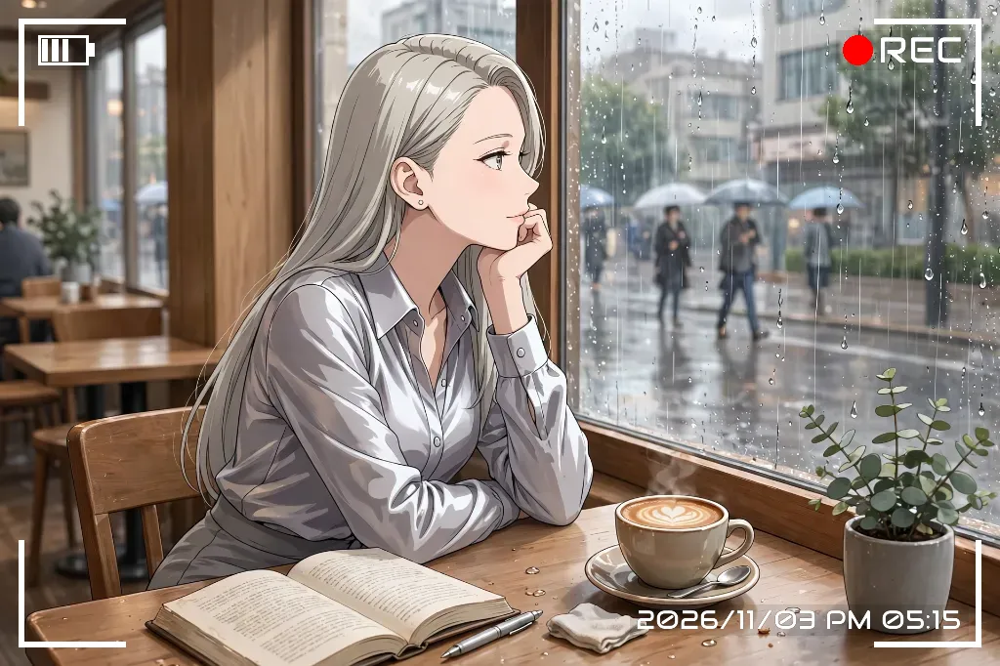

<div align="center">

# 🎬 rec-frame-agent

### Seamless REC viewfinder frame compositor tailored for AI agents, triggered by a single phrase: "Add my favorite frame."

[](pyproject.toml)
[](pyproject.toml)
[](LICENSE)
[](https://github.com/treeturtlefall-arch/rec-frame-app)
[](skill/SKILL.md)
[](DESIGN.md)

<br />

**[🇺🇸 English](README.md)** | **[🇯🇵 日本語 (Japanese)](README_JA.md)**

<br />

[Why rec-frame-agent?](#-why-rec-frame-agent-the-antithesis--core-values) • [Features](#-key-features--core-values) • [Architecture](#-system-architecture) • [For AI Agents](#-autonomous-setup-guide-for-ai-agents-museai--llms) • [CLI & Quickstart](#-quickstart--cli-reference) • [Specifications](#-specifications--capabilities-catalog) • [FAQ](#-frequently-asked-questions-faq)

<br />

<p align="center">
  
  
</p>

*Say "Add my favorite frame" to Muse, and get pixel-perfect frames without ambiguity or manual confirmation.*

</div>

---

## 💡 Why rec-frame-agent? (The Antithesis & Core Values)

Compositing a camcorder-style **REC frame (corner brackets, battery indicator, recording dot, and timecode)** onto images sounds simple, yet traditional implementations suffer from multiple **failure modes**:

- ❌ **Fixed-Resolution PNG Stretching**: Corners blur and lines distort when stretched across varying resolutions and aspect ratios.
- ❌ **The Blowout / Blackout Problem**: White text vanishes on high-key or bright backgrounds, while dark frames disappear on night shots.
- ❌ **Agent Friction & Hallucinations**: Standard CLI tools output unstructured human prose. LLM agents fail to parse resulting paths and hallucinate invalid flags.
- ❌ **Environment-Dependent Missing Glyphs**: Missing OS fonts result in ugly "tofu" boxes for seven-segment LED displays.

**rec-frame-agent** bundles the battle-tested rendering engine of [rec-frame-app](https://github.com/treeturtlefall-arch/rec-frame-app) and introduces a **thin, bulletproof translation layer** designed specifically for autonomous AI agents, resolving these pitfalls mathematically and structurally.

### 📊 Approach Comparison

| Aspect / Philosophy | Naive PNG Overlay | Generic CLI / Script | This Project (`rec-frame-agent`) |
|:---|:---|:---|:---|
| **Geometric Precision** | Corners stretch and blur across arbitrary aspect ratios | Manual configuration required per resolution | **Relative short-edge geometry** (Pixel-perfect guarantees at any resolution) |
| **Text Legibility** | Pure white text completely blows out on bright scenes | Simple drop shadows easily drowned out | **Auto-inverting Smart Cushion** (Semi-transparent background mathematically guarantees contrast) |
| **Agent Affinity** | Requires manual GUI interaction | Returns unstructured text; errors require guessing | **100% Headless & Structured JSON / Deterministic exit codes (0/2/3/4/5)** |
| **Reproducibility** | Requires prompts with 10+ command-line options | Manual editing of JSON config files | **"favorite" 1-word resolution & Diff-based preset inheritance** |
| **Hallucination Prevention**| LLMs guess unsupported parameters and fail | Brute-force regex parsing of `--help` | **Dynamic `capabilities` catalog** (Engine constants returned directly as JSON) |
| **Source Image Safety** | High risk of destructive file overwrites | Easy to overwrite on misconfigured flags | **Source image strictly protected (Automatic sequential naming `_rec_01`)** |

---

## ✨ Key Features & Core Values

### 1. 🎬 Cinematic Camcorder Viewfinder Aesthetics
Renders mathematical corner brackets, multi-level battery indicators (0–4 bars), vibrant REC dots, and precision timecodes cleanly matched to any image dimensions.

### 2. 🛡️ "Smart Cushion" Anti-Blowout Background
When overlay text is white, placing it over bright skies or white backgrounds makes it unreadable. rec-frame-agent automatically places a subtle, color-aware translucent box (default `10%` opacity) behind labels: dark cushions under white text and light cushions under black text.

### 3. 🕒 Flexible Timecode & Timezone Engine
Effortlessly switch between "Processed Timestamp", "Photo Timestamp (EXIF captured date with fallback to mtime)", "Fixed Custom Timestamp", or "No Timestamp".

### 4. 🎯 Frictionless "Favorite" Resolver
AI agents don't need to pass dozen of arguments. When a user requests "Apply my favorite frame", the agent simply resolves `favorite` (default: `ai-photo-white`) in a single command.

### 5. 🔤 Zero-Tofu Bundled OSS Fonts
Comes pre-packaged with 8 curated open-source fonts: 7-segment LED (DSEG7), 14-segment LED (DSEG14), futuristic HUD (Audiowide), retro dot-matrix (VT323), tall condensed bold (Bebas Neue), and Japanese CJK (Zen Kaku Gothic). Identical rendering is guaranteed across headless Linux containers, Windows, and macOS without installing OS fonts.

---

## 🏛️ System Architecture

This repository does not duplicate rendering logic. It bundles the upstream engine (`v8` schema) directly and focuses strictly on being a clean, deterministic translation layer for agents.

<details>
<summary><b>📐 View Internal Pipeline & Translation Layer Architecture (ASCII Art)</b></summary>

```
[ User / Client ]
      │
      ▼ "Add my favorite frame"
[ AI Agent (Muse.ai / LLM) ]
      │
      ├─► ① Discovery: rec-frame-agent capabilities --json (Dynamic catalog of axes)
      ├─► ② Execution: rec-frame-agent apply input.png --preset favorite --json
      │
      ▼
┌────────────────────────────────────────────────────────┐
│ rec-frame-agent (This repository: Thin Agent Layer)    │
│                                                        │
│  ┌──────────────────┐    ┌──────────────────────────┐  │
│  │ Preset Resolver  │───►│ Runner & CLI Normalizer  │  │
│  │ (favorites.json) │    │ (Collision handling,     │  │
│  └──────────────────┘    │  sequential naming)      │  │
│                          └────────────┬─────────────┘  │
│                                       │                │
│  ┌──────────────────┐                 ▼                │
│  │ JSON Reporter    │◄─── [ Execution & Errors ]       │
│  │ (Exit Codes 0/2-5│                                  │
│  └──────────────────┘                                  │
└───────────────────────────────────────┼────────────────┘
                                        │
                                        ▼
┌────────────────────────────────────────────────────────┐
│ rec-frame-app Engine (Bundled pixel-perfect core)      │
│                                                        │
│  ┌────────────────┐  ┌────────────────┐  ┌───────────┐ │
│  │ rec_overlay    │  │ rec_batch      │  │ rec_config│ │
│  │ (Math & Box)   │  │ (EXIF & IO)    │  │ (Schema)  │ │
│  └────────────────┘  └────────────────┘  └───────────┘ │
│                                                        │
│   Bundled Assets: 8 OSS Fonts + 10 Dot Assets          │
└───────────────────────────────────────┬────────────────┘
                                        │
                                        ▼
                   [ Output Image: input_rec.png ]
```

</details>

---

## 🤖 Autonomous Setup Guide for AI Agents (Muse.ai / LLMs)

When this repository URL is provided to an autonomous AI agent, execute the following **3 steps** to install and self-diagnose:

### Step 1. Install Dependencies
Fully compatible with headless environments (no GUI / no Tkinter required).
```bash
git clone <REPOSITORY_URL>
cd rec-frame-agent
uv tool install .        # or: pip install .
```

### Step 2. Deploy Muse Skill
```bash
# Linux / macOS
bash scripts/install_skill.sh

# Windows (PowerShell)
powershell -ExecutionPolicy Bypass -File scripts\install_skill.ps1
```
> [!NOTE]
> Deploys the skill definition to `~/workspace/custom-skills/rec-frame-agent/SKILL.md`, enabling the agent to recognize natural-language triggers like "Add my favorite frame" or "Fix washed-out text".

### Step 3. Run Self-Diagnostics
```bash
rec-frame-agent doctor --json
```
Verify all check items return `"ok": true`.

### 📋 Agent Execution Rules (Best Practices)
1. **Always invoke with `--json`**:
   ```bash
   rec-frame-agent apply <IMAGE_PATH> --json
   ```
2. **Structured Response Handling**:
   When `"ok": true`, extract the output path from `"output"` and attach it along with the timecode string (`"timecode"."text"`).
3. **Deterministic Exit Codes**:
   - `2` (Config error): Inspect available presets via `rec-frame-agent presets list`.
   - `3` (Input error): Verify input file existence (never substitute arbitrary files).
   - `4` (Output conflict): Omit `-o` to allow automatic sequential numbering.
   - `5` (Engine error): Run `doctor` and report environment discrepancies.

---

## 💻 Quickstart & CLI Reference

### Installation
```bash
# Recommended with uv
uv tool install .

# Or standard virtualenv / pip
python -m venv .venv
source .venv/bin/activate  # Windows: .venv\Scripts\activate
pip install .
```

### Common Commands

```bash
# 1. Composite 1 image using favorite settings (Default: ai-photo-white)
rec-frame-agent apply photo.png

# 2. Composite with a specific preset
rec-frame-agent apply photo.png --preset classic-black

# 3. Timecode mode variations
rec-frame-agent apply photo.png --timecode none          # Hide timestamp
rec-frame-agent apply photo.png --timecode photo         # EXIF captured date
rec-frame-agent apply photo.png --at 2026-11-03T14:30    # Custom fixed date

# 4. Smart cushion opacity adjustment (Anti-blowout)
rec-frame-agent apply photo.png --bg-opacity 0.25       # Enhanced contrast
rec-frame-agent apply photo.png --bg-opacity 0.0        # Disable cushion

# 5. Batch processing a directory
rec-frame-agent batch input_dir output_dir --json
```

### Managing Presets & Favorites
```bash
# List all presets and active favorite
rec-frame-agent presets list

# Switch default favorite
rec-frame-agent presets set-favorite classic-black

# Create new preset based on current favorite with diffs, and set as favorite
rec-frame-agent presets create my-cyber --base favorite --color cyan --dot glow_cyan --favorite

# Discover full capabilities dynamically
rec-frame-agent capabilities --json
```

---

## 📋 Specifications & Capabilities Catalog

Dynamically generated from `rec-frame-agent capabilities --json`.

| Axis | Choices / Range | Default (Favorite) | Note |
|:---|:---|:---|:---|
| **Frame Color (`color`)** | `white`, `black`, `green`, `cyan`, `red`, `yellow`, Custom HEX | `white` | Smart cushion color automatically inverts |
| **Font (`font`)** | 8 bundled OSS fonts + OS system fonts | `Audiowide(ワイドHUD)` | `DSEG14 Classic` recommended for LED retro look |
| **REC Dot (`dot`)** | `classic`, `flat_*` (5 colors), `glow_*` (5 colors) | `flat_red` | Glow series creates great cyberpunk aesthetic |
| **Battery Level (`battery_bars`)**| `0`, `1`, `2`, `3`, `4` | `3` | Can also be toggled off |
| **Smart Cushion (`bg_opacity`)** | `0.0` to `1.0` (0% to 100%) | `0.10` (10%) | `0.25` recommended for high-contrast scenes |
| **Texture Effect (`effect`)** | `off`, `oled`, `2000s` (Degradation 0–6) | `off` (`0`) | Applied strictly to overlay layer |
| **Timecode Mode** | `processed_at`, `photo`, `fixed`, `none` | `processed_at` | Processed time is agent standard |

---

## ❓ Frequently Asked Questions (FAQ)

### Q. Why is DSEG14 recommended over DSEG7?
> A. 7-segment LED (DSEG7) lacks glyphs for colons (`:`), slashes (`/`), and certain letters, causing missing glyph boxes ("tofu") depending on timestamp formats. 14-segment LED (DSEG14) covers full alphanumeric symbols cleanly.

### Q. How do I prevent white text from disappearing on light photos?
> A. Increase the cushion opacity with `--bg-opacity 0.20` to `0.30`. When the frame color is white, a subtle dark semi-transparent box is automatically placed behind the text, ensuring crisp legibility.

### Q. What are the roles of rec-frame-app vs rec-frame-ComfyUI vs rec-frame-agent?
> A.
> - **[rec-frame-app](https://github.com/treeturtlefall-arch/rec-frame-app)**: Upstream GUI application and canonical rendering engine source.
> - **[rec-frame-ComfyUI](https://github.com/treeturtlefall-arch/rec-frame-ComfyUI)**: ComfyUI custom nodes for video workflows and frame sequences.
> - **rec-frame-agent (This repository)**: CLI & skill interface purpose-built for autonomous AI agents (Muse.ai, etc.).

---

## 📄 License & Attributions

- **rec-frame-agent**: [MIT License](LICENSE)
- **Bundled Rendering Engine**: [rec-frame-app](https://github.com/treeturtlefall-arch/rec-frame-app) (MIT License) - See [`UPSTREAM.md`](UPSTREAM.md).
- **Bundled Fonts**: Distributed under their respective open-source licenses (SIL OFL, etc.). See `src/rec_frame_agent/engine/fonts/` and `src/rec_frame_agent/fonts/`.
