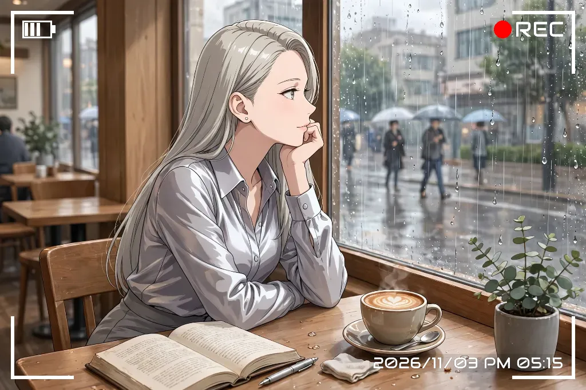

<div align="center">

# 🎬 rec-frame-agent

### 「お気に入りのフレームをつけて」で迷わず決まる、AIエージェント特化型 REC ファインダー合成エンジン

[](pyproject.toml)
[](pyproject.toml)
[](LICENSE)
[](https://github.com/treeturtlefall-arch/rec-frame-app)
[](skill/SKILL.md)
[](DESIGN.md)

<br />

**[🇺🇸 English](README.md)** | **[🇯🇵 日本語 (Japanese)](README_JA.md)**

<br />

[なぜ必要なのか？](#-なぜ-rec-frame-agent-が必要なのかアンチテーゼと核心) • [特長](#-主要な特長とコアバリュー) • [アーキテクチャ](#-システムアーキテクチャ) • [エージェント向け導入](#-aiエージェント向け自律導入ガイド-museai--agents) • [CLI・人間向け](#-クイックスタート--cliリファレンス) • [スペック・能力](#-スペック一覧--能力カタログ) • [FAQ](#-よくある質問-faq)

<br />

<p align="center">
  
  
</p>

*「お気に入りのフレームをつけて」と Muse に言えば、確認なしに迷わず・再現可能にフレームが付く。*

</div>

---

## 💡 なぜ rec-frame-agent が必要なのか？（アンチテーゼと核心）

画像やイラストにカメラファインダー風の **REC フレーム（四隅枠・電池残量・録画インジケーター・タイムコード）** を合成する作業は、一見シンプルに見えて多くの **「破綻ポイント」** を抱えています。

- ❌ **固定解像度 PNG の拡大・縮小**: 解像度が変わると枠線がボケる、あるいはアスペクト比で四隅が歪む。
- ❌ **白飛び・黒飛びの壁**: 明るい写真では白い文字や枠が背景に溶け、暗いシーンでは黒い枠が見えなくなる。
- ❌ **AIエージェントの迷いとハルシネーション**: CLI が自然言語テキストしか返さない場合、エージェントは出力ファイル名を推測できず、存在しないパラメータを捏造して自爆する。
- ❌ **環境依存のフォント崩壊**: 実行環境に特定フォントがないと、LED 表示が豆腐（文字化け）になり再現性が損なわれる。

**rec-frame-agent** は、実績ある本家 [rec-frame-app](https://github.com/treeturtlefall-arch/rec-frame-app) の描画エンジンを内蔵し、エージェントとエンジンの間に **「薄く堅牢な翻訳層」** を提供することで、これらの課題を数学的・構造的に解決します。

### 📊 アプローチ比較表

| 項目・設計思想 | 従来の素朴な実装（PNG重畳） | 一般的な画像CLI / スクリプト | 本プロジェクト (`rec-frame-agent`) |
|:---|:---|:---|:---|
| **幾何学的描画精度** | 固定枠PNGの引き伸ばしで四隅が歪む・ボケる | 解像度ごとの調整が手動・設定が長大 | **短辺基準の相対幾何計算**（任意解像度でピクセル完全保証） |
| **文字の視認性** | 白背景や高輝度シーンで白文字が完全に白飛び | 影（ドロップシャドウ）程度で埋没しやすい | **自動反転スマート座布団**（枠色連動の半透明下地で視認性を数理保証） |
| **エージェント親和性** | GUI操作必須でヘッドレス環境非対応 | 戻り値が非構造化テキスト、エラー推測が必要 | **完全ヘッドレス ＆ 構造化 JSON / 決定論的終了コード (0/2/3/4/5)** |
| **設定の再現性** | 毎回 10 以上の引数をプロンプトで指示 | 設定ファイルの直接編集が必要 | **「お気に入り (favorite)」1単語解決 ＆ 差分プリセット継承** |
| **ハルシネーション防止** | LLMの知識に頼り未対応の値を指定して失敗 | `--help` を力技で正規表現パース | **動的 `capabilities` カタログ**（エンジン定数を直接 JSON で返却） |
| **元画像の安全性** | 上書き事故による不可逆なデータ喪失リスク | オプション指定ミスによる上書き | **元画像完全保護（自動連番 `_rec_01` で不可逆破壊を構造的排除）** |

---

## ✨ 主要な特長とコアバリュー

### 1. 🎬 プロフェッショナルなカメラファインダー演出
四隅のコーナークラケット、バッテリー残量アイコン（0〜4本）、鮮烈な REC インジケーター、高精度タイムコードを画像に合わせて数学的に美しくレンダリングします。

### 2. 🛡️ 文字の白飛び・黒飛びを自動防止する「スマート座布団」
枠や文字が白の場合、明るい空や白い壁に重ねると文字が消滅します。本プロジェクトでは、枠色に連動した薄い半透明ボックス（座布団、既定 `10%`）をテキスト背面に自動配置。白枠には暗い下地、黒枠には明るい下地を自動で敷くため、あらゆる構図で視認性を保証します。

### 3. 🕒 柔軟なタイムコード・タイムゾーン制御
「処理した現在時刻」「写真の撮影日時（EXIF情報から自動取得、なければ mtime）」「固定の指定日時」「タイムスタンプ非表示」を瞬時に切り替え可能です。

### 4. 🎯 エージェントが迷わない「お気に入り」リゾルバ
エージェントは毎回複雑な引数を渡す必要はありません。ユーザーが「いつものフレームをつけて」と言えば、`favorite`（既定: `ai-photo-white`）を参照して **1 コマンド** で実行できます。

### 5. 🔤 豆腐（文字化け）知らずの同梱 OSS フォント群
7セグLED（DSEG7）、14セグLED（DSEG14）、近未来HUD（Audiowide）、レトロドット（VT323）、細長大文字（Bebas Neue）、日本語対応（Zen Kaku Gothic）など計 8 種の OSS フォントをリポジトリ内に完備。OS フォントが一切インストールされていないコンテナやクラウド環境でも同一の結果を再現します。

---

## 🏛️ システムアーキテクチャ

本プロジェクトは描画機能を独自に再実装しません。本家の実績ある描画コア（`v8` スキーマ）をそのまま内蔵し、エージェントのための翻訳層として徹しています。

<details>
<summary><b>📐 内部パイプラインと翻訳層の構造を表示（ASCII Art）</b></summary>

```
[ ユーザー / クライアント ]
      │
      ▼ 「お気に入りのフレームをつけて」
[ AI エージェント (Muse.ai / 各種 LLM) ]
      │
      ├─► ① 探索: rec-frame-agent capabilities --json (可能な軸・選択肢を動的把握)
      ├─► ② 実行: rec-frame-agent apply input.png --preset favorite --json
      │
      ▼
┌────────────────────────────────────────────────────────┐
│ rec-frame-agent (本リポジトリ: エージェント向け薄い翻訳層)     │
│                                                        │
│  ┌──────────────────┐    ┌──────────────────────────┐  │
│  │ Preset Resolver  │───►│ Runner & CLI Normalizer  │  │
│  │ (favorites.json) │    │ (衝突回避・連番命名・引数正規化)│  │
│  └──────────────────┘    └────────────┬─────────────┘  │
│                                       │                │
│  ┌──────────────────┐                 ▼                │
│  │ JSON Reporter    │◄─── [ 実行結果・エラーハンドリング ] │
│  │ (Exit Codes 0/2-5│                                  │
│  └──────────────────┘                                  │
└───────────────────────────────────────┼────────────────┘
                                        │
                                        ▼
┌────────────────────────────────────────────────────────┐
│ rec-frame-app Engine (同梱された高精度描画エンジン)         │
│                                                        │
│  ┌────────────────┐  ┌────────────────┐  ┌───────────┐ │
│  │ rec_overlay    │  │ rec_batch      │  │ rec_config│ │
│  │ (幾何演算・座布団)│  │ (EXIF正規化・読込)│  │ (v8スキーマ)│ │
│  └────────────────┘  └────────────────┘  └───────────┘ │
│                                                        │
│   同梱アセット: OSSフォント 8種 + ドット素材 10種      │
└───────────────────────────────────────┬────────────────┘
                                        │
                                        ▼
                   [ 完成画像: input_rec.png ]
```

</details>

---

## 🤖 AIエージェント向け自律導入ガイド (Muse.ai / Agents)

AI エージェント（Muse.ai 等）に本リポジトリが渡された場合、以下の **3 ステップ** で自律導入およびヘルスチェックを完了してください。

### Step 1. インストール
GUI 不要・ヘッドレス環境完全対応です。
```bash
git clone <このリポジトリのURL>
cd rec-frame-agent
uv tool install .        # または pip install .
```

### Step 2. Muse スキルの配置
```bash
bash scripts/install_skill.sh
```
> [!NOTE]
> スキル定義が `~/workspace/custom-skills/rec-frame-agent/SKILL.md` に配置され、エージェントが「お気に入りのフレームをつけて」「文字を見やすくして」などの自然言語トリガーを自律認識できるようになります。

### Step 3. 診断（Doctor チェック）
```bash
rec-frame-agent doctor --json
```
全項目の `"ok": true` を確認したら準備完了です。

### 📋 エージェントの実行鉄則（Best Practices）
1. **必ず `--json` を付けて実行する**:
   ```bash
   rec-frame-agent apply <対象画像パス> --json
   ```
2. **結果の構造化パース**:
   `"ok": true` の場合、`"output"` に格納された生成画像パスを取り出し、タイムコード（`"timecode"."text"`）とともにユーザーへ報告してください。
3. **決定論的終了コードの処理**:
   - `2` (設定エラー): `rec-frame-agent presets list` で実在するプリセットを再確認。
   - `3` (入力エラー): 対象画像パスが存在するか確認（別ファイルを推測で代用しない）。
   - `4` (出力エラー): `-o` を外して自動連番に任せる。
   - `5` (エンジンエラー): `doctor` を実行し、環境不整合を報告。

---

## 💻 クイックスタート ＆ CLIリファレンス

### インストール方法
```bash
# uv をお使いの場合（推奨）
uv tool install .

# 通常の Python venv / pip の場合
python -m venv .venv
source .venv/bin/activate  # Windows: .venv\Scripts\activate
pip install .
```

### よく使うコマンド集

```bash
# 1. お気に入り設定で 1 枚合成（既定: ai-photo-white）
rec-frame-agent apply photo.png

# 2. プリセットを指定して合成
rec-frame-agent apply photo.png --preset classic-black

# 3. タイムコードの柔軟な切り替え
rec-frame-agent apply photo.png --timecode none          # タイムスタンプなし
rec-frame-agent apply photo.png --timecode photo         # 写真の撮影日時（EXIF連動）
rec-frame-agent apply photo.png --at 2026-11-03T14:30    # 指定日時に固定

# 4. 文字を見やすくする座布団（半透明背景）の調整
rec-frame-agent apply photo.png --bg-opacity 0.25       # 濃いめ（白飛び防止を強化）
rec-frame-agent apply photo.png --bg-opacity 0.0        # 座布団なし

# 5. フォルダ内の一括バッチ処理
rec-frame-agent batch input_dir output_dir --json
```

### プリセットとお気に入りのカスタマイズ
```bash
# プリセット一覧とお気に入りを確認
rec-frame-agent presets list

# お気に入りを切り替える
rec-frame-agent presets set-favorite classic-black

# 現在のお気に入りをベースに差分プリセットを新規作成し、それをお気に入りに登録
rec-frame-agent presets create my-cyber --base favorite --color cyan --dot glow_cyan --favorite

# 利用可能なオプションや選択肢の一覧（能力カタログ）を動的取得
rec-frame-agent capabilities --json
```

---

## 📋 スペック一覧 ＆ 能力カタログ

`rec-frame-agent capabilities --json` から動的に返却されるスペック仕様です。

| 軸 (Axis) | 選択肢・範囲 | 既定値（お気に入り） | 備考 |
|:---|:---|:---|:---|
| **枠色 (`color`)** | `white`, `black`, `green`, `cyan`, `red`, `yellow`, 任意HEX | `white` | 背景に応じて座布団色が自動反転 |
| **フォント (`font`)** | 8種の同梱OSSフォント + OSシステムフォント | `Audiowide(ワイドHUD)` | レトロLEDには `DSEG14 Classic` 推奨 |
| **赤丸ドット (`dot`)** | `classic`, `flat_*` (5色), `glow_*` (5色) | `flat_red` | 発光（glow）系はサイバー感の演出に最適 |
| **電池残量 (`battery_bars`)**| `0`, `1`, `2`, `3`, `4` | `3` | アイコン自体を非表示にも可能 |
| **座布団 (`bg_opacity`)** | `0.0` 〜 `1.0`（0% 〜 100%） | `0.10` (10%) | 強いコントラストには `0.25` 推奨 |
| **エフェクト (`effect`)** | `off`, `oled`, `2000s` (レトロ劣化 0〜6) | `off` (`0`) | オーバーレイ層のみに質感を付与 |
| **タイムコード方式** | `processed_at`, `photo`, `fixed`, `none` | `processed_at` | エージェント向けには処理時が既定 |

---

## ❓ よくある質問 (FAQ)

### Q. なぜ DSEG7 ではなく DSEG14 を推奨するのですか？
> A. 7セグメントLED（DSEG7）にはコロン (`:`) やスラッシュ (`/`)、特定の英字のグリフが含まれておらず、日付やファイル形式によって豆腐（文字化け）が発生するリスクがあります。14セグメントLED（DSEG14）は英数字・記号を網羅しているため、エージェント環境でも安全に表示できます。

### Q. 白背景の写真で文字が溶けてしまいます。どうすれば良いですか？
> A. `--bg-opacity 0.20` 〜 `0.30` を指定して座布団を少し濃くしてください。枠色が白の場合は自動的に薄い黒の座布団が敷かれ、文字の輪郭がくっきりと浮かび上がります。

### Q. 本家 rec-frame-app や rec-frame-ComfyUI との違いは何ですか？
> A. 
> - **[rec-frame-app](https://github.com/treeturtlefall-arch/rec-frame-app)**: 人間向けの GUI アプリケーションおよび描画エンジンの正本。
> - **[rec-frame-ComfyUI](https://github.com/treeturtlefall-arch/rec-frame-ComfyUI)**: ComfyUI ワークフローおよび動画（連番フレーム）向けのノード。
> - **rec-frame-agent（本リポジトリ）**: AI エージェント（Muse 等）が会話から呼び出すための CLI ＆ スキル層。

---

## 📄 ライセンスと権利表記

- **rec-frame-agent**: [MIT License](LICENSE)
- **内蔵描画エンジン**: [rec-frame-app](https://github.com/treeturtlefall-arch/rec-frame-app) (MIT License) - 詳細は [`UPSTREAM.md`](UPSTREAM.md) を参照。
- **同梱フォント**: 各 OSS ライセンス（SIL Open Font License 等）に準拠。詳細は `src/rec_frame_agent/engine/fonts/` および `src/rec_frame_agent/fonts/` を参照。
